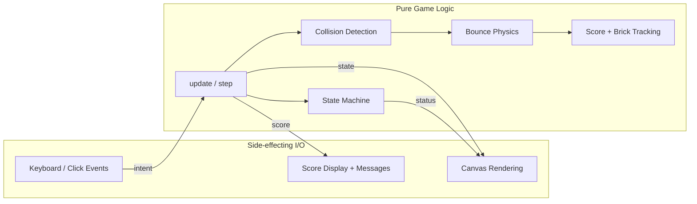
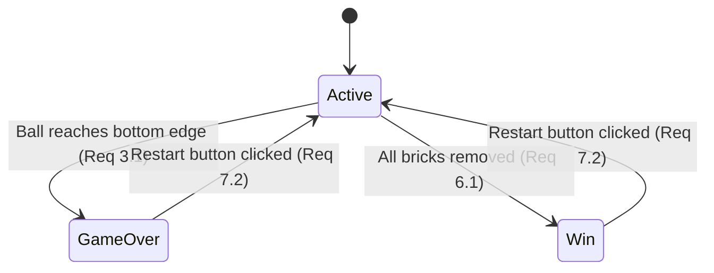

# Design Document: Paddle Ball Game

## Overview

This document describes the technical design for a classic Breakout-style paddle ball game implemented as a single-page web application. The game is packaged entirely in one `index.html` file containing inline CSS and inline vanilla JavaScript, renderable on an HTML5 `<canvas>` and openable directly in a browser without a server.

The game features a player-controlled paddle (left/right arrow keys), a continuously moving ball that bounces off walls, the paddle, and a single row of destructible bricks at the top of the canvas. The player scores one point per brick destroyed; clearing all bricks wins the game, while letting the ball pass the bottom edge loses the game. A restart button resets the game to its initial state.

The design centers on a clear separation between **pure game logic** (state transitions, physics, collision detection, score updates) and **side-effecting I/O** (canvas rendering, keyboard input, DOM events). This separation keeps the logic testable independently of the DOM and canvas, which is essential to the testing strategy described later.

### Research Summary

The implementation follows well-established patterns documented in the MDN "2D breakout game using pure JavaScript" tutorial series:

- **Game loop**: A `requestAnimationFrame` loop drives an update-then-render cycle each frame, keeping animation smooth and synced to the browser refresh rate, and pausing automatically when the tab is inactive. ([MDN — Bounce off the walls](https://developer.mozilla.org/en-US/docs/Games/Tutorials/2D_Breakout_game_pure_JavaScript/Bounce_off_the_walls))
- **Wall bouncing**: Each frame the ball's position is compared against the canvas edges; on collision the relevant velocity component is reversed. The tutorial notes that minor overlap is tolerable but recommends clamping the position to the edge to avoid the ball "sticking" in a wall. ([MDN — Bounce off the walls](https://developer.mozilla.org/en-US/docs/Games/Tutorials/2D_Breakout_game_pure_JavaScript/Bounce_off_the_walls))
- **Brick collision**: Each frame the engine loops over the bricks and compares each remaining brick's rectangle with the ball's coordinates; a hit removes the brick and reverses the ball. ([MDN — Collision detection](https://developer.mozilla.org/en-US/docs/Games/Tutorials/2D_Breakout_game_pure_JavaScript/Collision_detection))
- **Game over**: Detected when the ball reaches the bottom edge of the canvas. ([MDN — Game over](https://developer.mozilla.org/en-US/docs/Games/Tutorials/2D_Breakout_game_pure_JavaScript/Game_over))

## Architecture

The application is structured as a single-file game loop with an explicit finite state machine. Three top-level concerns are kept distinct:

1. **Input layer** — keyboard and click event listeners that translate raw browser events into intent (move paddle left/right, restart).
2. **Logic layer** — pure functions that evolve the game state: advancing the ball, clamping the paddle, detecting collisions, applying bounces, destroying bricks, updating the score, and transitioning the game state. These functions take a state object and return/produce a new state without touching the DOM or canvas.
3. **Render layer** — functions that read the current state and draw to the canvas, update the score text node, and show/hide terminal-state messages. Rendering has no influence on game logic.

A single `requestAnimationFrame` loop drives one frame: it calls `update(state, inputs)` to advance logic, then `render(state, ctx)` to paint. The loop checks the game status before advancing the ball, so the ball stops in terminal states (game over / win) per Requirements 3.3 and 6.3.

### Architecture Diagram

### State Machine

The game state machine has three states, driven directly by the requirements:

- **Active**: Ball moves, paddle responds to input, collisions are processed. (Requirements 1, 2, 4, 5)
- **GameOver**: Ball stops, a game-over message is shown. (Requirements 3.2, 3.3)
- **Win**: Ball stops, a win message is shown. (Requirements 6.2, 6.3)

Restart transitions back to Active and resets all state to initial values. (Requirement 7)

## Components and Interfaces

The JavaScript is organized into the following logical components. Because the code lives in a single file, these are implemented as plain functions and objects rather than separate modules, but the boundaries below are respected for clarity and testability.

### 1. Constants / Configuration
Holds fixed game parameters used across logic and rendering.

- `CANVAS_WIDTH`, `CANVAS_HEIGHT` — canvas dimensions.
- `BALL_RADIUS`, `BALL_SPEED` — ball size and per-frame speed.
- `PADDLE_WIDTH`, `PADDLE_HEIGHT`, `PADDLE_SPEED`, `PADDLE_Y` — paddle geometry and speed.
- `BRICK_COUNT`, `BRICK_WIDTH`, `BRICK_HEIGHT`, `BRICK_PADDING`, `BRICK_OFFSET_TOP`, `BRICK_OFFSET_LEFT` — single-row brick layout.
- `STATES = { ACTIVE, GAME_OVER, WIN }` — state machine enum.

### 2. State Factory
**Interface:** `createInitialState() -> GameState`

Builds the initial `GameState` (fresh ball at center moving, paddle centered, single row of bricks all present, score 0, status ACTIVE, no keys pressed). Used both on first load and on restart.

### 3. Input Handler
**Interface:** attaches `keydown`/`keyup` listeners (arrow keys) and a `click` listener on the restart button.

- `setKey(state, 'left' | 'right', pressed)` — records key intent into the state's `keys` map.
- On restart click, calls `reset(state)`.

### 4. Update / Step (Pure Logic)
**Interface:** `update(state) -> GameState` (mutates and returns `state`)

One frame of logic. Internally orchestrates, in order:
1. `updatePaddle(state)` — move paddle according to `state.keys`, then `clampPaddle(state)` to keep it within horizontal bounds (Requirement 1.3).
2. `updateBall(state)` — only when `state.status === ACTIVE`, advance the ball by `(dx, dy)` (Requirement 2.1).
3. `bounceWalls(state)` — reverse velocity and clamp position against top/left/right walls (Requirements 2.2–2.4); if the ball passes the bottom edge, transition to `GAME_OVER` (Requirement 3.1).
4. `collidePaddle(state)` — if the ball overlaps the paddle while moving downward, reverse vertical direction upward (Requirement 2.5).
5. `collideBricks(state)` — loop over bricks; on the first brick hit, remove it, reverse vertical direction, and increment the score (Requirements 4.2, 4.3, 5.2).
6. `checkWin(state)` — if no bricks remain, transition to `WIN` (Requirement 6.1).

### 5. Collision Detection (Pure Helpers)
- `ballHitsWall(state, edge)` — top/left/right boundary tests using `ballRadius`.
- `ballHitsPaddle(state)` — circle/rect overlap test combined with a downward-motion guard.
- `ballHitsBrick(state, brick)` — bounding-box overlap test between the ball and a brick rectangle.
- `clampPaddle(state)` — clamps `paddle.x` to `[0, CANVAS_WIDTH - PADDLE_WIDTH]`.

### 6. Renderer (Side Effects)
**Interface:** `render(state, ctx) -> void`

- `clearCanvas(ctx)` — clears the frame.
- `drawBall(state, ctx)` — `ctx.arc(...)` with `BALL_RADIUS`.
- `drawPaddle(state, ctx)` — filled rectangle.
- `drawBricks(state, ctx)` — iterates bricks, drawing only those with `exists === true`.
- `drawScore(state)` — updates the score text node (Requirement 5.3).
- `drawMessages(state)` — shows game-over / win messages based on `state.status` (Requirements 3.2, 6.2).

### 7. Game Loop
**Interface:** `loop()` — calls `update(state)`, then `render(state, ctx)`, then `requestAnimationFrame(loop)`.

### 8. Reset / Restart
**Interface:** `reset(state) -> GameState` — reassigns every field of `state` to initial values and sets status to `ACTIVE` (Requirements 7.1, 7.2). Implemented by replacing `state`'s fields in place so the loop and listeners keep referencing the same object.

## Data Models

All game state lives in a single `GameState` object. The models below are plain JS objects (no classes required), but the field contracts are fixed so the logic functions can be reasoned about and tested independently.

### Ball
| Field | Type | Description |
|-------|------|-------------|
| `x` | number | Center x coordinate (px). |
| `y` | number | Center y coordinate (px). |
| `dx` | number | Per-frame horizontal velocity (px/frame). |
| `dy` | number | Per-frame vertical velocity (px/frame). |
| `radius` | number | Ball radius (px), equals `BALL_RADIUS`. |

### Paddle
| Field | Type | Description |
|-------|------|-------------|
| `x` | number | Left edge x coordinate (px). |
| `y` | number | Top edge y coordinate (px), fixed at `PADDLE_Y`. |
| `width` | number | Paddle width (px). |
| `height` | number | Paddle height (px). |
| `speed` | number | Per-frame horizontal speed (px/frame). |

### Brick
| Field | Type | Description |
|-------|------|-------------|
| `x` | number | Left edge x coordinate (px). |
| `y` | number | Top edge y coordinate (px). |
| `width` | number | Brick width (px). |
| `height` | number | Brick height (px). |
| `exists` | boolean | Whether the brick is still on the canvas. |

### GameState
| Field | Type | Description |
|-------|------|-------------|
| `ball` | Ball | Current ball state. |
| `paddle` | Paddle | Current paddle state. |
| `bricks` | Brick[] | Flat array of bricks for the single row (Requirement 4.1). |
| `score` | number | Current score, increments per brick (Requirement 5.2). |
| `status` | `'ACTIVE' \| 'GAME_OVER' \| 'WIN'` | Current game state machine state. |
| `keys` | `{ left: boolean, right: boolean }` | Current pressed-state of the arrow keys. |

### Design Decisions and Rationale

- **`requestAnimationFrame` over `setInterval`**: Browser-synced refresh, smoother animation, and automatic pausing when the tab is inactive — the standard for canvas games.
- **Separate `update`/`render`**: Pure logic is decoupled from canvas/DOM, so physics and collision logic can be unit- and property-tested without a browser environment.
- **Explicit state machine**: A single `status` field with three values makes the terminal-state ball-stop requirements (3.3, 6.3) trivially correct — the loop simply skips ball advancement when `status !== ACTIVE`.
- **Position clamping on wall bounce**: After reversing velocity at a wall, the ball position is clamped to the wall edge. This avoids the overlap-accumulation "stuck in wall" bug noted in the MDN tutorial, and keeps the bounce idempotent.
- **Downward-motion guard on paddle bounce**: The paddle collision only reverses the ball when it is moving downward and overlaps the paddle. This prevents the ball from "sticking" to the paddle and bouncing repeatedly while in contact.
- **Single first-hit brick per frame**: `collideBricks` removes one brick and reverses once per frame. Because the bricks form a single row and the ball reverses vertically on contact, this keeps the score increment aligned with one brick per collision event (Requirement 5.2) and avoids double-counting.
- **Flat brick array**: Requirement 4.1 specifies a single row, so a one-dimensional array is the simplest faithful representation. (A 2D grid is unnecessary and would over-engineer the requirement.)

## Correctness Properties

*A property is a characteristic or behavior that should hold true across all valid executions of a system — essentially, a formal statement about what the system should do. Properties serve as the bridge between human-readable specifications and machine-verifiable correctness guarantees.*

### Property Reflection (Redundancy Elimination)

Before writing the properties, the testable acceptance criteria from the prework were reviewed for redundancy and consolidation:

- **1.1 + 1.2** are symmetric (paddle moves left/right at fixed speed) → consolidated into one directional-movement property.
- **2.2 + 2.3 + 2.4** are symmetric wall bounces (top/left/right) → consolidated into one wall-bounce property.
- **3.3 + 6.3** are the same invariant (ball freezes in terminal states) → consolidated into one terminal-state idempotence property.
- **4.1 + 5.1** are both invariants of the initial state → consolidated into one initial-state property.
- **4.2 + 4.3 + 5.2** all occur on the single brick-collision event → consolidated into one brick-collision property.
- **7.1 + 7.2** both describe the reset result → consolidated into one reset property.

The display criteria (3.2, 5.3, 6.2) and packaging criteria (8.1, 8.2, 8.3) are not universal logic properties and are covered by example tests and smoke checks respectively (see Testing Strategy).

### Property 1: Paddle moves at fixed speed in the pressed direction

*For any* `GameState` with `status === ACTIVE` and exactly one of `keys.left`/`keys.right` pressed, after one `update` step the paddle's `x` changes by exactly `PADDLE_SPEED` toward the pressed edge (decreasing for left, increasing for right), provided the move does not reach a boundary.

**Validates: Requirements 1.1, 1.2**

### Property 2: Paddle stays within canvas bounds

*For any* `GameState` and any combination of pressed keys, after one `update` step the paddle's `x` satisfies `0 <= paddle.x <= CANVAS_WIDTH - paddle.width`.

**Validates: Requirements 1.3**

### Property 3: Ball advances at constant speed in the active state

*For any* `GameState` with `status === ACTIVE` in which the ball does not collide with a wall, paddle, or brick during the step, after `update` the ball's new position equals `old position + (dx, dy)` and the speed magnitude `sqrt(dx*dx + dy*dy)` is unchanged.

**Validates: Requirements 2.1**

### Property 4: Wall bounces reverse the perpendicular velocity and keep the ball in bounds

*For any* `GameState` with `status === ACTIVE` where the ball reaches a wall: hitting the top wall sets `dy > 0` (downward) and clamps `y` to the top; hitting the left wall sets `dx > 0` (rightward) and clamps `x` to the left; hitting the right wall sets `dx < 0` (leftward) and clamps `x` to the right. In every case the ball remains within `[0, CANVAS_WIDTH]` horizontally and `y >= 0` vertically.

**Validates: Requirements 2.2, 2.3, 2.4**

### Property 5: Paddle bounce reverses the ball upward

*For any* `GameState` with `status === ACTIVE` where the ball overlaps the paddle and is moving downward (`dy > 0`), after `update` the ball's `dy` is negative (upward).

**Validates: Requirements 2.5**

### Property 6: Bottom edge triggers game over

*For any* `GameState` with `status === ACTIVE` where the ball's `y + radius >= CANVAS_HEIGHT`, after `update` the status becomes `GAME_OVER`.

**Validates: Requirements 3.1**

### Property 7: Ball freezes in terminal states

*For any* `GameState` whose `status` is `GAME_OVER` or `WIN`, after `update` the ball's `x`, `y`, `dx`, and `dy` are unchanged (the ball does not move).

**Validates: Requirements 3.3, 6.3**

### Property 8: Initial state has a single row of bricks and a zero score

*For any* call to `createInitialState`, the `bricks` array is non-empty, every brick shares the same `y` coordinate (a single row) with `exists === true`, the `score` is `0`, and `status` is `ACTIVE`.

**Validates: Requirements 4.1, 5.1**

### Property 9: Brick collision removes the brick, reverses the ball, and increments the score

*For any* `GameState` with `status === ACTIVE` where the ball overlaps an existing brick, after `update` that brick's `exists` becomes `false`, the ball's `dy` is negated, and the `score` increases by exactly `1`.

**Validates: Requirements 4.2, 4.3, 5.2**

### Property 10: All bricks removed triggers a win

*For any* `GameState` with `status === ACTIVE` where every brick has `exists === false`, after `update` the status becomes `WIN`.

**Validates: Requirements 6.1**

### Property 11: Reset returns to the initial active state

*For any* `GameState` (including mid-game, partial, and terminal states), after `reset` the resulting state equals `createInitialState()` in `ball`, `paddle`, `bricks` (all `exists === true`), and `score`, and the `status` is `ACTIVE` with a non-zero ball velocity so movement resumes.

**Validates: Requirements 7.1, 7.2**

## Error Handling

The game is a self-contained client-side application with no network, storage, or external service dependencies, so error handling focuses on robustness of the game loop and input handling rather than external failures.

- **Unrecognized input**: Only the left/right arrow keys and the restart button are significant. All other key events are ignored; no error is raised.
- **Ball-wall overlap**: If the ball's position overshoots a wall by more than one step (e.g., a large velocity), `bounceWalls` clamps the position to the wall edge after reversing velocity. This prevents the ball from "sticking" inside a wall or tunneling out of the canvas.
- **Paddle out of bounds**: `clampPaddle` clamps `paddle.x` to `[0, CANVAS_WIDTH - PADDLE_WIDTH]` after every movement, so even unexpected positions (from a bad initial state or a large step) are corrected.
- **Spurious paddle bounce**: The paddle collision is guarded by a downward-motion check (`dy > 0`). A ball moving upward that grazes the paddle edge is not bounced, preventing the ball from oscillating on the paddle.
- **Double brick hit per frame**: `collideBricks` processes the first overlapping brick and reverses once, so the ball cannot destroy two bricks in a single frame or increment the score twice.
- **Empty brick configuration**: If `BRICK_COUNT` were set to `0`, the game would enter `WIN` immediately. The configuration is fixed at a positive `BRICK_COUNT` to avoid a degenerate instant-win; the code asserts/guards `BRICK_COUNT >= 1`.
- **Canvas context failure**: Before starting the loop, the code checks that `canvas.getContext('2d')` returns a valid context. If it does not, the loop is not started and a message is logged to the console; the game degrades gracefully rather than throwing during rendering.
- **Restart in any state**: `reset` replaces every tracked field with initial values regardless of current `status`, so restarting mid-flight, during game-over, or during a win all produce a valid fresh active state.
- **Tab inactivity**: `requestAnimationFrame` is paused by the browser when the tab is inactive, so the game naturally pauses without manual time-delta handling.

## Testing Strategy

The testing strategy follows a dual approach: **property-based tests** for the universal game-logic invariants and **unit/integration tests** for specific examples, edge cases, and side-effecting behavior. The pure logic layer (physics, collision, state transitions, reset) is the target of property-based testing; the rendering/DOM layer is tested with examples.

### Test Environment

- **Language/Library**: JavaScript with [fast-check](https://fast-check.dev/) for property-based testing and a standard unit-test runner (e.g., Vitest or Jest) for example tests.
- **DOM/Canvas mocking**: The pure logic functions depend only on constants and the `GameState` object, not on the DOM or canvas. To test them outside a browser, the inline `<script>` is loaded into a [jsdom](https://github.com/jsdom/jsdom) environment with `document`, `requestAnimationFrame`, and a stub `canvas.getContext('2d')` mocked. The pure logic functions are exposed on a testable namespace (e.g., `window.Game`) so the test harness can call them directly.

### Property-Based Tests

Each correctness property above (Properties 1–11) is implemented as a single fast-check property test. Each test generates random valid inputs, applies the relevant logic function, and asserts the property holds.

- **Minimum 100 iterations** per property test (fast-check default is 100; do not lower it).
- **Generator design**: Custom arbitraries generate random `GameState` values, including edge cases the generators must cover:
  - Ball positioned exactly on a wall, and deep past a wall.
  - Ball at a canvas corner (simultaneous wall contacts).
  - Ball moving upward vs. downward near the paddle.
  - All bricks removed, and exactly one brick remaining.
  - Paddle starting out of bounds (negative or past the right edge).
- **Each test is tagged** with a comment referencing its design property, in the format:
  `/* Feature: paddle-ball-game, Property 1: Paddle moves at fixed speed in the pressed direction */`
- **Library**: Use fast-check; do not implement property-based testing from scratch.

### Unit Tests (Examples and Edge Cases)

Example-based unit tests cover criteria that are side-effecting or specific scenarios:

- **Req 3.2**: When `status === GAME_OVER`, rendering shows the game-over message (element visible/has expected text).
- **Req 5.3**: After a score change, the score display text node reflects the current score value.
- **Req 6.2**: When `status === WIN`, rendering shows the win message.
- **Edge cases**:
  - Ball moving upward near the paddle does not bounce off it.
  - Ball exactly at the bottom edge (`y + radius === CANVAS_HEIGHT`) triggers game over.
  - Hitting the last brick simultaneously transitions to win and the ball stops.
  - Restarting during `WIN` and during `GAME_OVER` both yield a fresh active state.

### Smoke / Static Checks

The single-file packaging requirements are verified with structural checks rather than runtime tests:

- **Req 8.1**: Assert the deliverable consists of a single `index.html` (no separate JS/CSS source files are required to run).
- **Req 8.2**: Assert `index.html` contains an inline `<style>` element.
- **Req 8.3**: Assert `index.html` contains an inline `<script>` element with no external `src` attribute.

### Integration Test (Optional)

An optional end-to-end check loads `index.html` in a headless browser (Playwright), drives a deterministic sequence of arrow-key inputs, and verifies the score increments and a terminal-state message eventually appears. This validates the wiring of input, loop, logic, and render together, complementing the isolated logic tests.

### Coverage Mapping

| Requirement | Test Type | Property/Test |
|-------------|-----------|---------------|
| 1.1, 1.2 | Property | Property 1 |
| 1.3 | Property | Property 2 |
| 2.1 | Property | Property 3 |
| 2.2, 2.3, 2.4 | Property | Property 4 |
| 2.5 | Property | Property 5 |
| 3.1 | Property | Property 6 |
| 3.2 | Example | Unit test |
| 3.3 | Property | Property 7 |
| 4.1 | Property | Property 8 |
| 4.2, 4.3 | Property | Property 9 |
| 5.1 | Property | Property 8 |
| 5.2 | Property | Property 9 |
| 5.3 | Example | Unit test |
| 6.1 | Property | Property 10 |
| 6.2 | Example | Unit test |
| 6.3 | Property | Property 7 |
| 7.1, 7.2 | Property | Property 11 |
| 8.1, 8.2, 8.3 | Smoke | Static checks |

Every acceptance criterion is covered by at least one test type, and every universal logic invariant is expressed as a property-based test with a minimum of 100 iterations.
